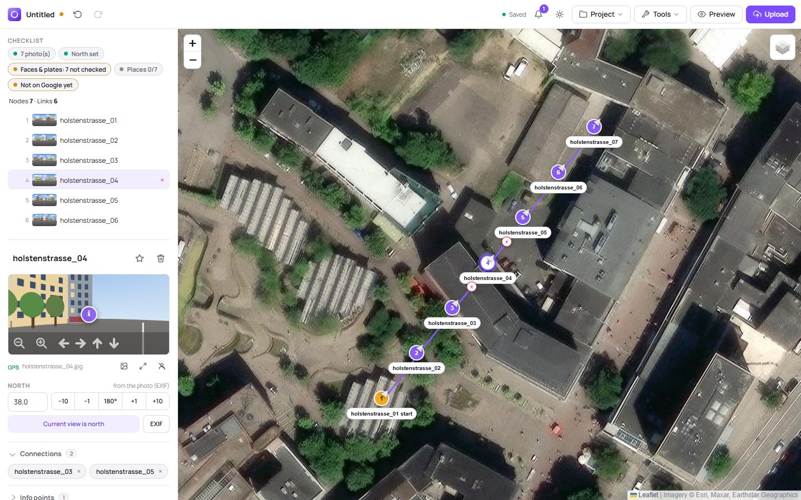
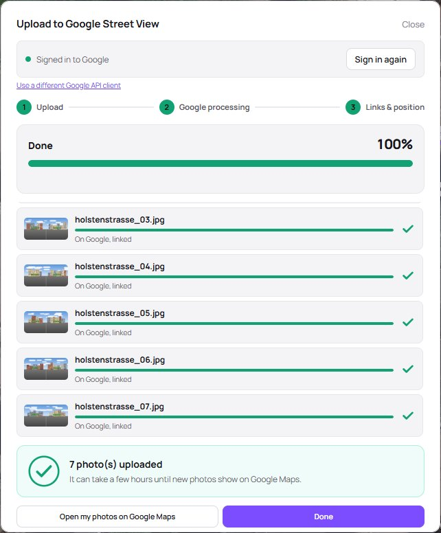
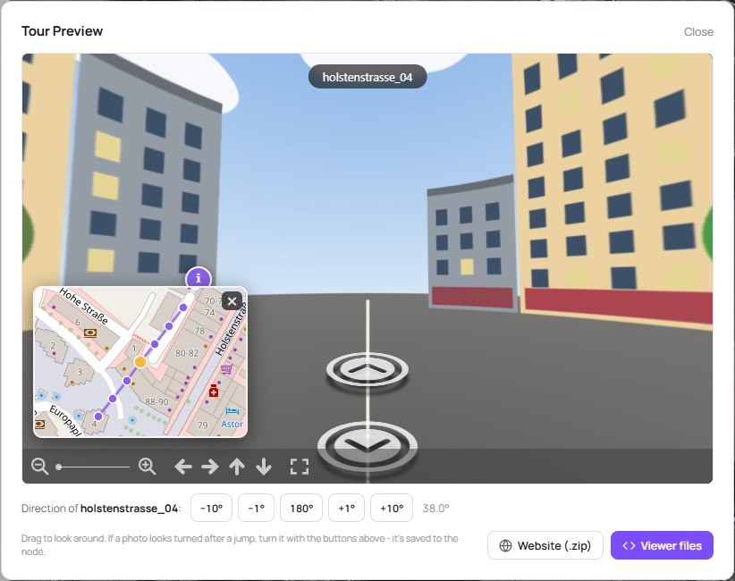
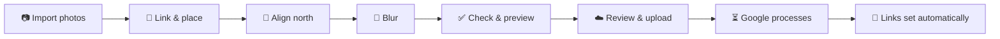

<div align="center">


# Streetview Tour Editor

**Turn a walk with your 360° camera into a connected Google Street View tour.**<br>
Place, link and align your panoramas on a map, blur faces, preview the walkthrough,
and publish everything to Google Maps with one click.

[](https://github.com/F0uP/streetview-tour-uploader/releases/latest)
[](https://github.com/F0uP/streetview-tour-uploader/releases)
[](https://github.com/F0uP/streetview-tour-uploader/actions/workflows/build-release.yml)
[](LICENSE)


[**Download**](#quick-start) ·
[Quick start](#quick-start) ·
[Google setup](#one-time-google-setup) ·
[User guide](#user-guide) ·
[FAQ](#faq--troubleshooting)

<picture><source media="(prefers-color-scheme: dark)" srcset="docs/images/editor-dark.jpg"></picture>

</div>

---

## Why

Google Street View lets anyone publish 360° photos, and connected photos become a
walkable tour on Google Maps. Google's own tools for this are gone, and the
[Street View Publish API](https://developers.google.com/streetview/publish) is
not something you want to drive by hand. This editor does the whole job: from a
folder of panoramas from a RICOH THETA, Insta360, GoPro MAX or any other 360°
camera to a published, linked tour.

Everything runs on your own computer. Your photos only leave it when you upload
them to Google.

## Features

| | |
|---|---|
| 📥 **A whole walk in one go** | Drop a folder (or many photos) and the **import** places them by GPS, links them in the order you walked, turns them to north from the walking direction and checks the tour. One Ctrl+Z takes it all back. |
| 🗺️ **Plan on a map** | Edit on a street or satellite map: link photos by right-clicking, or let **auto-connect** chain them in the order you walked. **Several tours** on one map – add projects next to each other, export each tour on its own. |
| 📍 **Places on Google Maps** | Optional, recommended: every photo tied to its building, house number or street, by a rule you can see and change before anything is uploaded. |
| 🧭 **Get north right** | Align one photo by looking north and clicking once, and let the others follow – from the **walking direction**, or by **comparing the photos with each other**, whichever way you held the camera. Fine-tune by ±1°/±10°/180°; the preview shows the result exactly as visitors will see it. |
| 📍 **No GPS? No problem** | Place photos from a **GPX track** recorded on your phone, or type exact coordinates. GPS a few metres off? **Move or turn the whole tour**, or **snap it to the paths** on OpenStreetMap. |
| 🙈 **Privacy built in** | **Blur faces and licence plates** before uploading: the editor checks **all photos at once** for faces and vehicles – on your computer – and you go through the findings one by one. The Street View Publish API does not blur anything itself. |
| ✅ **Catch problems early** | A **checklist** shows what is left for each tour, a **tour check** finds what Google would reject (not 2:1, not a JPEG, over 75 MB) and what looks wrong, and a **review before publishing** says exactly what goes public. |
| ☁️ **One-click publishing** | Upload with a live progress view, readable errors and automatic linking once Google has processed the photos. Later changes are **pushed without re-uploading**; the Google status and **view counts** show on every point. **Floors** for tours inside buildings. |
| 🎥 **360° videos** | Upload a 360° video with its GPS track and Google makes the Street View photos from it. The editor checks the video and the track first and shows how far Google got. |
| 🌐 **Share it anywhere** | Export a **ready-to-host website** of the tour (with info points and a minimap), or `tour-viewer.html` / `tour-config.json` / `tour.csv`. |
| 💾 **Never lose work** | Autosave, a restore prompt after a crash, and `.vrtour` project files with all photos inside. **Ctrl+S** saves back into the open project; **recent projects** are one click away. |
| 🖥️ **A real desktop app** | For **Windows, macOS and Linux** (also ARM). Its own window, no browser needed, **works offline** (only the map and Google need the internet); a calm **light and dark design**, a short **introduction on first start** and a **sample tour** to try things, a **panorama focus mode**, the system's own open and save dialogs, `.vrtour` file association, installers, in-app updates on Windows and update hints on macOS and Linux (or updates through **apt**). English and German user interface. |

<table>
  <tr>
    <td width="50%"><picture><source media="(prefers-color-scheme: dark)" srcset="docs/images/upload-dark.jpg"></picture></td>
    <td width="50%"><picture><source media="(prefers-color-scheme: dark)" srcset="docs/images/preview-dark.jpg"></picture></td>
  </tr>
  <tr>
    <td align="center"><sub>Upload: progress, per-photo status, automatic linking</sub></td>
    <td align="center"><sub>Preview: walk the tour, fix a photo's direction on the spot</sub></td>
  </tr>
</table>

## Quick start

Get the file for your system from the
[latest release](https://github.com/F0uP/streetview-tour-uploader/releases/latest):

| System | Download | |
|---|---|---|
| **Windows** 10 / 11 (64-bit, also ARM) | `StreetviewTourEditor-<version>-Setup.exe` | installer, no admin rights needed |
| Windows, 32-bit | `StreetviewTourEditor-<version>-Setup-x86.exe` | |
| Windows, without installing | `StreetviewTourEditor-<version>-windows-x64-portable.zip` | unzip, run `StreetviewTourEditor.exe` |
| **macOS** 11+ on Apple Silicon (M1 …) | `StreetviewTourEditor-<version>-macos-arm64.dmg` | open, drag the app to *Applications* |
| macOS 11+ on Intel | `StreetviewTourEditor-<version>-macos-x64.dmg` | |
| **Linux**: Debian 12+, Ubuntu 24.04+ and derivatives (amd64 and arm64) | `streetview-tour-editor_<version>_all.deb` | `sudo apt install ./streetview-tour-editor_*_all.deb` |

On Linux you can also add the editor's apt repository, so updates come with the
system's own:

```bash
curl -fsSL https://f0up.github.io/streetview-tour-uploader/apt/key.gpg | sudo tee /usr/share/keyrings/streetview-tour-editor.gpg > /dev/null
echo "deb [signed-by=/usr/share/keyrings/streetview-tour-editor.gpg] https://f0up.github.io/streetview-tour-uploader/apt stable main" | sudo tee /etc/apt/sources.list.d/streetview-tour-editor.list
sudo apt update && sudo apt install streetview-tour-editor
```

Then start **Streetview Tour Editor** (Start menu, Launchpad or your app menu)
and drop your 360° photos, or the whole folder, onto the map. The editor opens in its own window;
closing the window quits the app. Not sure yet? **Try the sample tour** on the
start screen: a small tour with drawn photos, to try everything (it is never uploaded).

The window is the system's own web engine: Edge WebView2 on Windows (part of
Windows 10 and 11), WKWebView on macOS, WebKitGTK on Linux (installed with the
package). Without it the editor opens in your browser instead. On Windows on
ARM the 64-bit build runs through Windows' x64 emulation.

> [!NOTE]
> Releases aren't code-signed yet. **Windows** SmartScreen may say *"Windows protected your PC"*:
> click **More info → Run anyway**. **macOS** says it can't check the app for malware the first
> time: open **System Settings → Privacy & Security** and click **Open Anyway** (or right-click the
> app → **Open**). Each release has a `SHA256SUMS.txt` to verify the downloads.

### Run from source

Requires **Python 3.11+**. On Linux the window also needs the system's GTK
bindings: `sudo apt install python3-gi gir1.2-webkit2-4.1` (and create the
virtual environment with `--system-site-packages`).

```bash
git clone https://github.com/F0uP/streetview-tour-uploader.git
cd streetview-tour-uploader
pip install -r requirements.txt
python run_editor.py            # --browser: use the browser instead of the window
```

Closing the window stops it. In the browser, keep the terminal open while you
work; <kbd>Ctrl</kbd>+<kbd>C</kbd> stops it, and so does closing the last editor
tab (`--keep-running` turns that off).

## One-time Google setup

Every app that publishes to Street View must be registered with Google as an
**OAuth client**: Google offers no other way. It's free, takes about five
minutes, and you only do it once. The editor walks you through it: click
**Upload to Google** and follow the five steps, each with a link to the right
page.

<details>
<summary><b>The steps in detail</b></summary>

1. [Create a Google Cloud project](https://console.cloud.google.com/projectcreate)
   (any name) and make sure it is selected at the top.
2. [Enable the Street View Publish API](https://console.cloud.google.com/apis/library/streetviewpublish.googleapis.com).
3. [Set up the OAuth consent screen](https://console.cloud.google.com/apis/credentials/consent):
   any app name, your e-mail, audience **External**, then add your own Google
   address under **Audience → Test users**.
4. [Create an OAuth client](https://console.cloud.google.com/apis/credentials/oauthclient)
   of type **Desktop app**.
5. Paste the **Client ID** and **Client Secret** into the editor, or choose the
   downloaded `client_secret_….json`, and click **Save & Continue**. Then
   **Sign in with Google**.

</details>

> [!IMPORTANT]
> While the consent screen is in **Testing** mode, Google ends the sign-in after
> **7 days**. The editor then shows *"Sign-in expired"*. Just sign in again. To
> avoid that, set the consent screen's publishing status to **In production**
> (Google may show an *"unverified app"* warning on sign-in, which you can
> continue past for your own account).

The Client ID/Secret and the sign-in token stay on your computer:
`%APPDATA%\StreetviewTourEditor\` for the Windows app, `uploader/` when running
from source. They are never part of a build or a project file.

## User guide



The **checklist** at the top of the side panel follows you through these steps:
for the tour of the selected point it shows what is done (green) and what is left
(yellow) – photos, north, faces & plates, places, Google. Click a chip to go where
it gets done. Messages that pop up at the bottom are kept under the **bell** in the
top bar, in case one vanished too fast.

### 1. Bring in your photos

- **Drop a folder or several photos** onto the map, or use **Project → Import
  photos…** (<kbd>Ctrl</kbd>+<kbd>I</kbd>; subfolders such as `DCIM/100RICOH` are
  included). The import does the groundwork in one step, each part optional:
  - places every photo at its GPS position (EXIF/XMP),
  - links them in the order they were taken (capture time, else file name),
    skipping gaps longer than you set,
  - sets north from the walking direction for photos without a compass heading
    (this assumes the camera's front faced where you walked),
  - then runs the tour check.

  Photos already in the tour are skipped, and one <kbd>Ctrl</kbd>+<kbd>Z</kbd>
  undoes the whole import. A single dropped photo lands where you drop it.
- **No GPS?** Record a track with any GPS logger app while shooting and give it to
  the import, or use **Tools → Place photos from GPX track…** later (there you
  can also set the camera clock's time zone if the photos don't land on the track).
- **Double-click** the map for an empty point; **Replace Photo** in the side
  panel swaps a node's photo.
- **GPS a few metres off?** **Tools → Move or turn a tour…** shifts the whole tour
  in 1 or 5 m steps or turns it about its centre, watching the satellite map; it
  all counts as one undo step. **Snap to paths** moves each point onto the nearest
  street or footpath from OpenStreetMap (the tour's area is sent to the Overpass
  API for this).
- **Inside a building with several floors?** Give the points their **floor** in
  the side panel (*Position*). Google shows the floor switcher for them, and the
  map's floor buttons show one floor at a time.

### 2. Link the photos

- **Right-click** a node, then **right-click** the next one. Click the **×** on a
  line to remove the link.
- **Tools → Auto-connect nodes…** links them in the order the photos were taken
  (capture time) or to their nearest neighbours, up to a distance you choose.
- **Shift+drag** on the map or **Ctrl+click** selects several nodes; the bar at
  the bottom connects or deletes them in one go.

### 3. Align north

Each photo needs to know which way its centre faces, or arrows point the wrong
way and you look backwards after a jump.

- Select a node, turn the panorama in the side panel until you face **north**
  (the satellite map helps), and click **Current view is north**.
- Fine-tune with **−10° / −1° / 180° / +1° / +10°**. **180°** fixes a photo taken
  facing backwards.
- **Tools → Headings from walking direction…** sets all photos at once: align one
  by hand, pick it as reference, and the others follow your route.
- **Tools → North from the photos…** works however you held the camera: it
  compares each photo's horizon with its linked neighbours and turns them to match
  the photo you aligned. Every result says how sure it is; only clear ones are
  ticked, and nothing changes until you apply them.

> [!TIP]
> In the **Preview**, walk through the tour. If a photo looks turned after a jump,
> use the buttons under the viewer: they turn the photo you are standing in, live.

### 4. Protect privacy

**Tools → Check all photos for faces & plates…** looks through every photo – on
your computer, nothing is sent anywhere – and lists those with faces or vehicles.
**Review** opens each in the blur tool with the suggestions marked; after applying
you are back at the list. Or select a node and click **Blur faces & plates…**:

- **Detect faces** and **Detect plates** suggest boxes (dashed); click a box to
  remove it. For plates the editor finds vehicles and suggests the lower middle of
  each, where plates usually are – remove the boxes without one.
- Drag boxes over anything else, such as house numbers.
- **Apply to photo** pixelates them for good. The original EXIF block, which can
  hold an unblurred thumbnail, is dropped; the 360° metadata is kept.

If the photo was already uploaded, the next upload replaces it and deletes the
unblurred version on Google.

### 5. Check and preview

- **Tools → Check tour…** lists errors (block the upload) and warnings, each with
  a **Show** button.
- **Preview** shows the tour exactly as it will look, including info points and the
  minimap.
- Press <kbd>F</kbd> (or the expand button under the panorama) to see the selected
  photo over the **whole window**, and walk on to the linked points from there.
  <kbd>Esc</kbd> goes back.
- **Info points:** in the side panel, **Info points → Add at current view** puts a
  clickable "i" with a title, text and link into the panorama.

### 6. Upload to Google Street View

Click **Upload**, then **Start Upload**. First comes the **review before
publishing**: how many photos go up or are updated, and per tour whether north,
links, places and the privacy check are complete – each open point with a way to
fix it first. **Publish** starts the upload:

1. **Upload:** each photo is sent with its position and heading, with live progress, speed and time left.
2. **Google processing:** new photos take a few minutes before Google accepts links. The dialog waits.
3. **Links & position:** connections are set on Google.

Good to know:

- **Only what changed is sent.** Running the upload again uploads new photos only;
  moved, turned or re-linked photos are **updated on Google without re-uploading**.
- Photos Google hasn't finished yet get their links **automatically in the
  background** while the editor is open.
- **Tools → Compare with Google** (also in the upload dialog) reads every photo
  back from Google and compares links, position and heading with your tour. It
  shows whether each photo is *published*, *processing* or *rejected*, finds photos
  the editor lost track of and duplicates at the same spot. **Repair** sends
  whatever is missing, again without re-uploading.
- **Tools → Views on Google…** shows how often each photo has been viewed on
  Google Maps, per tour.
- **Places on Google Maps** (optional, recommended): see below. Without it you can
  still type a **Place ID** by hand; Google's free
  [Place ID Finder](https://developers.google.com/maps/documentation/javascript/examples/places-placeid-finder)
  finds it, and pasting a Maps URL that contains one works too. If Google rejects
  a place, the photos are uploaded without it and you are told.

#### Places on Google Maps (optional, recommended)

With an API key of your own (**Tools → Places on Google Maps…**, which walks you
through it), every photo is tied to its place on Google Maps: the **building or
business** it was taken at, its **house number** or its **street**. Nothing
happens unseen: when you open the upload, each tour shows the rule that applied
and why, and **Show the place of each photo** lists every photo with its place,
kind and distance. Every choice can be changed per tour (automatic, each photo its
house number or street, one place for the whole tour, no place) or per photo,
also for photos already on Google (sent without uploading again). The side panel
shows each point's place, the upload list each photo's.

The automatic rule, in order:

1. A tour that lies at one place (all points within 60 m of its centre) with a
   building or business within 40 m of that centre: all photos get that place.
2. Otherwise each photo gets its house number if that is within 25 m, else its street.
3. Nothing found: the photo goes up with its position only.

It decides for photos not on Google yet; photos already there keep their place
unless you change it.

Costs: the key needs the **Places API (New)** and the **Geocoding API**, and Google
requires a billing account for them. Each has a free monthly usage (2026: 10,000
address lookups and 5,000 place searches; above that about $5 and $32 per 1,000 –
see [Google's prices](https://developers.google.com/maps/billing-and-pricing/pricing)).
The editor looks up each photo once (again only after you move it) and searches
for buildings only for tours that lie at one place; the upload dialog shows how
many lookups it sent. Set a **daily limit** on each API's quota page (the guide
suggests 300 and 150 a day) and Google stops at the free usage instead of
charging. The key stays on your computer; only the positions of the photos you
upload are sent to these APIs.

> [!WARNING]
> Uploaded photos are **public**, under your Google account. It can take from a
> few minutes to several hours until they show on Google Maps.

#### 360° videos

**Tools → Upload a 360° video…** sends a 360° video to Google, which picks the
frames, places them along the GPS track and links them – the photos then appear
under your account like uploaded ones. The video does not become part of your tour.
Before anything is sent, the editor reads the video and shows what Google needs:

- a 360° video, 2:1 (equirectangular, as the camera's app exports it), with its 360°
  metadata, recorded while walking or driving outdoors;
- GPS for the whole video: in the video's motion track (CAMM, e.g. Insta360 with a
  GPS remote) or as a **GPX file** recorded at the same time. The editor shows how
  much of the video the track covers, fills gaps of up to 30 s along the track
  (Google refuses gaps over 5 s) and notices when the camera wrote its local time
  as UTC – **Shift by … h** fixes that.

The video goes from your computer through the app straight to Google, also when it
is several GB. Processing takes hours to days; **Your videos on Google** shows how
far each got, or why Google refused it.

### 7. Save, share and export

| | |
|---|---|
| **Project → Save** (<kbd>Ctrl</kbd>+<kbd>S</kbd>) | A `.vrtour` file: one zip with the tour and all photos. Once saved or opened, <kbd>Ctrl</kbd>+<kbd>S</kbd> saves straight back into it (in the browser: Chrome/Edge; Firefox downloads a copy). Double-click a `.vrtour` to open it in the app. |
| **Project → Website with photos** | `index.html` + photos in a `.zip`, ready for any web space. |
| **Project → Viewer files** | `tour-viewer.html` + `tour-config.json`, to place next to your photos. Also in the preview. |
| **Project → CSV** | `tour.csv` for the [command-line uploader](#command-line-tools). |
| **Project → Export folder** | Save every export straight into one folder instead of asking each time. |

**Several tours on one map:** **Project → Add project…** (<kbd>Ctrl</kbd>+<kbd>Shift</kbd>+<kbd>O</kbd>,
several files at once; or drop `.vrtour` files on a map that has points) puts
projects next to each other instead of replacing what is there. A tour is a group
of linked points, or the points of one project or imported folder; with more
than one, each gets its own colour, its own start point and a row in the side
panel (click to show it, double-click to rename it). Every export then asks
which tour – or everything – it is for, and **Project → Tour as project** saves a
single tour as a `.vrtour` of its own. After adding projects, <kbd>Ctrl</kbd>+<kbd>S</kbd>
asks for a new file, so the files you opened stay as they were.

**Recent projects** are listed in the **Project** menu and on the start screen
(in the browser only in Chrome and Edge, which ask once for access again).

The editor also **autosaves** as you work. After a crash it offers to restore
the last session.

### Keyboard shortcuts

| Action | Shortcut |
|---|---|
| Command palette (all actions) | <kbd>Ctrl</kbd>+<kbd>K</kbd> |
| Light / dark design | the sun / moon button in the top bar |
| Introduction again | **Tools → Introduction** |
| Save / Save as / Open project | <kbd>Ctrl</kbd>+<kbd>S</kbd> / <kbd>Ctrl</kbd>+<kbd>Shift</kbd>+<kbd>S</kbd> / <kbd>Ctrl</kbd>+<kbd>O</kbd> |
| Import photos | <kbd>Ctrl</kbd>+<kbd>I</kbd> |
| Add project to the map | <kbd>Ctrl</kbd>+<kbd>Shift</kbd>+<kbd>O</kbd> |
| Undo / Redo | <kbd>Ctrl</kbd>+<kbd>Z</kbd> / <kbd>Ctrl</kbd>+<kbd>Y</kbd> |
| Add point | Double-click the map |
| Connect two nodes | Right-click, right-click |
| Select several | <kbd>Ctrl</kbd>+click, or <kbd>Shift</kbd>+drag on the map |
| Delete selection | <kbd>Delete</kbd> |
| Panorama over the whole window | <kbd>F</kbd> |
| Cancel / deselect | <kbd>Esc</kbd> |
| All shortcuts | <kbd>?</kbd> |

## FAQ & troubleshooting

<details>
<summary><b>"Sign-in expired" / uploads fail with "not signed in"</b></summary>

Google ends the sign-in after 7 days while your OAuth consent screen is in
*Testing* mode. Click **Sign in with Google** again, or switch the consent
screen to *In production* (see [Google setup](#one-time-google-setup)).
</details>

<details>
<summary><b>Google rejected the Place ID</b></summary>

The photos are uploaded without a place in that case. Look the place up in the
[Place ID Finder](https://developers.google.com/maps/documentation/javascript/examples/places-placeid-finder)
and copy the ID it shows (usually starting with `ChIJ`). Not every address has a
Place ID Google accepts for Street View photos.
</details>

<details>
<summary><b>My photos show up on Google Maps one by one, not as a connected tour</b></summary>

The links between photos are set *after* Google has finished processing them,
so a tour only becomes walkable once that step went through. Open
**Tools → Compare with Google**: it lists every photo whose links, position or
heading differ on Google, and **Repair** sends them. The north direction does not
decide whether photos are linked; it only turns the arrows. After a repair it can
take a few hours until Google Maps shows the links.
</details>

<details>
<summary><b>The status says "processing" for a long time</b></summary>

That's Google, not the editor: new photos can take hours to be published. Links
and position updates are sent automatically as soon as Google accepts them. Keep
the editor open, or press **Start Upload** again later. Nothing is uploaded twice.
</details>

<details>
<summary><b>A photo faces the wrong way, or I look backwards after a jump</b></summary>

Its north is off, often because the camera's compass was. Open **Preview**, walk
to that photo and use **180°** or **±10°** under the viewer, or fix it in the side
panel. Then upload again: only the heading is sent.
</details>

<details>
<summary><b>Google says it's not a 360° photo</b></summary>

The photo must be a 2:1 equirectangular JPEG. Image editors such as GIMP often
strip the 360° (GPano XMP) metadata on save; `uploader/restore_xmp.py` copies it
back from the originals. The tour check warns about both.
</details>

<details>
<summary><b>The map stays grey / "Access blocked"</b></summary>

Don't open `editor/editor.html` by double-click: OpenStreetMap blocks map tiles
for `file://` pages. Start the app (or `python run_editor.py`) and use
<http://127.0.0.1:8420/editor.html>.
</details>

<details>
<summary><b>My work from the browser version is missing in the app window</b></summary>

Up to version 2.2 the editor ran in your browser, and its autosave lives in that
browser. While the app is running, open <http://127.0.0.1:8420/editor.html> in
that browser, restore the session there and save it as a project
(<kbd>Ctrl</kbd>+<kbd>S</kbd>). Then open the `.vrtour` file in the app.
</details>

<details>
<summary><b>"This page is not connected to the Streetview Tour Editor app"</b></summary>

The page was opened without the app's key, e.g. from an old bookmark or after
clearing the browser's site data. Open the editor from the Start menu or the tray
icon; it passes the key along. Your autosaved work is still there.
</details>

<details>
<summary><b>"Could not start on port 8420"</b></summary>

Another program, often an older copy of the editor, uses the port. Close it
(in browser mode: from its tray icon) and start again.
</details>

<details>
<summary><b>macOS: "Apple could not verify … is free of malware"</b></summary>

The app isn't signed with an Apple developer certificate yet. Open
**System Settings → Privacy & Security**, scroll down and click **Open Anyway**
(once). Or right-click the app in *Applications* → **Open**.
</details>

<details>
<summary><b>Linux: the editor opens in the browser instead of its own window</b></summary>

The window needs WebKitGTK and a desktop session. The package pulls in
`gir1.2-webkit2-4.1`; on other distributions install your equivalent of
`python3-gi` and WebKit2GTK 4.1 (or 4.0). Started from a terminal
(`streetview-tour-editor`), the app prints what it is missing.
</details>

<details>
<summary><b>Something doesn't work - how do I report it?</b></summary>

**Tools → Create a bug report…** saves a zip with the versions of the app and
your system, the app's log and the editor's last messages and errors. It holds no
photos, projects, sign-in or keys; anything in the log that looks like a key or
token is blanked. Have a look inside, then attach it to a
[new issue](https://github.com/F0uP/streetview-tour-uploader/issues/new).
</details>

<details>
<summary><b>How do I update on macOS or Linux?</b></summary>

The editor tells you when there is a new version. **Download** shows what to do on
your system: the disk image for your Mac, the `.deb` with the command to install
it – or, with the [apt repository](#quick-start), nothing beyond your system's
updates (`sudo apt update && sudo apt upgrade`).
</details>

<details>
<summary><b>Where are my files?</b></summary>

| What | Windows | macOS | Linux |
|---|---|---|---|
| Google sign-in, settings, recent projects, Places API key, `editor.log` | `%APPDATA%\StreetviewTourEditor\` | `~/Library/Application Support/StreetviewTourEditor/` | `~/.config/streetview-tour-editor/` |
| Autosaved session | `%LOCALAPPDATA%\StreetviewTourEditor\WebView2\` | WebKit's storage for the app | `~/.local/share/streetview-tour-editor/` |
| Projects | wherever you save your `.vrtour` files | | |

Running from source keeps everything in `uploader/` (`client_secrets.json`,
`token.json`, `.editor_key`, `recent.json`, `places_api_key.txt`, `filerefs.json`, `webview/`). In browser mode the autosave lives in
that browser's storage for `127.0.0.1:8420`.
</details>

## Command-line tools

For scripting and batch jobs, the [`uploader/`](uploader) folder has
stand-alone scripts. They share the sign-in with the editor.

| Script | What it does |
|---|---|
| `upload_tour.py` | Upload a folder of photos. Without a manifest it links them in file order; with `--manifest tour.csv` it uses your links. `--place-id`, `--dry-run`, `--connect-only`. |
| `gen_tour_csv.py` | Build `tour.csv` from an exported `tour-config.json` plus the photos' EXIF GPS. |
| `retry_failed.py` | Re-upload only the photos that failed, then redo the links. |
| `restore_xmp.py` / `restore_exif.py` | Copy 360° metadata / GPS back into photos an image editor stripped. |
| `find_place_id.py` | Look up a Place ID by name (needs a Google Maps API key). |

```bash
python uploader/gen_tour_csv.py --config tour-config.json --folder photos --out photos/tour.csv
python uploader/upload_tour.py  --folder photos --manifest photos/tour.csv --dry-run
```

See [`example/`](example) for the CSV format and `tour-meta.json` (a Place ID for a whole folder).

## Privacy & security

- The editor is a small local web server bound to `127.0.0.1`. It only answers
  requests from its own page (host and origin are checked), so other websites
  can't use it.
- Every API call needs a random key, so other programs or users on the same
  computer can't use your Google sign-in through the editor either. The app
  window gets a fresh key on every start, so browser tabs from earlier sessions
  lose access.
- In the app window, files are read and written only where you picked them in
  the system's own open / save / folder dialogs; the page can't name any other path.
- The Google sign-in opens in your default browser (Google doesn't allow it in
  embedded windows), listens on a local port only for that moment and checks the
  `state` parameter of the reply.
- Closing the window quits the app; nothing keeps running in the background. In
  browser mode the app quits about 15 seconds after the last editor tab is
  closed, and at the latest 5 minutes after no editor page has been heard from.
- Photos and projects stay on your computer until you upload them; uploads go
  directly to Google's Street View Publish API. Face and vehicle detection runs on
  your computer. **Snap to paths** sends the tour's area (not the photos) to the
  OpenStreetMap Overpass API.
- In the app window, the autosave keeps photos you opened from a file by
  reference (path, size and time in `filerefs.json`) instead of a second copy; a
  changed or moved file is reported, never silently replaced.
- A bug report is only made when you ask for it, and only saved to your computer.
- In-app updates download only from this repository's GitHub releases and are
  checked against the release's `SHA256SUMS.txt` before installing.
- All code ships with the app: the libraries (map, panorama viewer, face
  detection, font) are in `editor/vendor/`, pinned and checked by SHA-256. The
  editor works offline; only the map tiles (OpenStreetMap, Esri) and Google need
  the internet. The exported website carries its libraries too.

## Development

<details>
<summary><b>Project layout</b></summary>

```text
editor/editor.html        the editor's page (markup); editor.css its styles
editor/js/                the editor as native ES modules, no build step: editor.js (main),
                          i18n-de.js (German), align.js (north from the photos), detect.js
                          (faces, vehicles), video.js (360° videos), viewer.js, gpx.js, zip.js, util.js
editor/sample/            the sample tour (made by packaging/make_sample.py)
editor/vendor/            third-party libraries, fetched and checked by packaging/vendor.py
run_editor.py             local server, its API endpoints, desktop-app entry point
google_api.py             Street View Publish API: photos and 360° videos
places.py                 Places API (New) and Geocoding API lookups
bug_report.py             "Create a bug report", with secrets blanked
app_window.py             the app window (WebView2 / WKWebView / WebKitGTK via pywebview)
app_tray.py               tray icon (browser mode)
app_update.py             in-app updates from GitHub Releases (Windows), update hints elsewhere
uploader/                 command-line tools
build_exe.py              builds the Windows app + installer, or the macOS app + .dmg
installer/                Inno Setup script (Windows installer)
packaging/icons/          the logo: icon.svg and make_icons.py, which renders every icon format
packaging/linux/          build_deb.py: the Linux package; apt_repo.py: the apt repository
packaging/signpath/       how to set up code signing with SignPath
packaging/macos/          entitlements for signing the macOS app
packaging/pyinstaller-hooks/  bundle only what the app needs
packaging/winget/         winget manifest generator
.github/workflows/        CI: tests on every push; build, smoke-test and release on every v* tag
tests/                    pytest + Playwright tests of the editor and the app
```
</details>

<details>
<summary><b>Tests</b></summary>

The tests start the app on a free port with a profile of their own and drive the
editor in headless Chromium; Google, OpenStreetMap and the Places APIs are faked.

```bash
pip install -r requirements-test.txt
python -m playwright install chromium     # or: set SVT_BROWSER_CHANNEL=chrome
pytest tests
```

CI runs them on every push and before every release build (`.github/workflows/tests.yml`).
The tests also check that every text of the editor has its German translation.
</details>

<details>
<summary><b>Building the apps</b></summary>

Windows (the Python's architecture, x64 or x86, decides the build) and macOS
(build on a Mac of the target architecture):

```bash
pip install -r requirements-build.txt
winget install JRSoftware.InnoSetup     # Windows, only for the Setup.exe
python build_exe.py                      # version from `git describe`
python build_exe.py --version 2.3.0      # explicit version
```

Output in `dist/`: on Windows the app folder, `…-portable.zip`, `…-Setup.exe`;
on macOS `Streetview Tour Editor.app` and the `.dmg`; plus `SHA256SUMS.txt`.
`--no-installer` skips Inno Setup; `--console` builds with a console window for
debugging.

Linux (needs `dpkg-deb`; run it with the oldest supported Python, 3.11):

```bash
python3 packaging/linux/build_deb.py --version 2.3.0
```

The editor's libraries are pinned in `packaging/vendor.py`. After changing a
version there, `python packaging/vendor.py --update` downloads them again and
rewrites the lock file; CI runs `--check` before every build.

The sample tour is made by `python packaging/make_sample.py` (drawn panoramas, no
real place or person in them).

Start the app with `--debug` for the developer tools in its window, with
`--browser` to use the browser instead, or with `--smoke-test` to check that it
starts and works (exit code 0), as CI does with every build.
</details>

<details>
<summary><b>Releasing</b></summary>

Push a tag and GitHub Actions builds every package (Windows x64 and x86, macOS
arm64 and x64, the Linux .deb), starts each one once on a fresh machine (the .deb
on Ubuntu 24.04 amd64 and arm64, Ubuntu 26.04 and Debian 12, the Windows build
also on Windows on ARM) and publishes the release. Installed Windows copies
offer the update on their next start:

```bash
git tag v2.3.0 && git push origin v2.3.0
```

**Run workflow** in the Actions tab builds and tests without releasing. Optional repository secrets:

- **Windows code signing** (removes the SmartScreen warning) via
  [Azure Trusted Signing](https://learn.microsoft.com/azure/trusted-signing/):
  `AZURE_TENANT_ID`, `AZURE_CLIENT_ID`, `AZURE_CLIENT_SECRET`,
  `TRUSTED_SIGNING_ENDPOINT`, `TRUSTED_SIGNING_ACCOUNT`, `TRUSTED_SIGNING_PROFILE`.
  Locally, set `SIGN_CMD` to any signing command with `{file}` as placeholder.
  Or, free for open source, [SignPath](https://signpath.org): `SIGNPATH_API_TOKEN`
  and the variables `SIGNPATH_ORGANIZATION_ID`, `SIGNPATH_PROJECT_SLUG`; see
  [packaging/signpath/README.md](packaging/signpath/README.md).
- **macOS signing and notarization** (removes the Gatekeeper warning):
  `MACOS_CERTIFICATE` (base64 of a *Developer ID Application* `.p12`),
  `MACOS_CERTIFICATE_PASSWORD`, and for notarization `APPLE_ID`, `APPLE_TEAM_ID`,
  `APPLE_APP_PASSWORD`. Locally, set `MACOS_SIGN_IDENTITY` (and the three Apple values).
- **winget**: `WINGET_TOKEN`; the first submission is manual, see
  [packaging/winget/README.md](packaging/winget/README.md).
- **apt repository** on GitHub Pages: `APT_GPG_PRIVATE_KEY`, an armored private key
  without passphrase made only for this (`gpg --quick-gen-key "Streetview Tour Editor
  apt" ed25519 sign never`, then `gpg --armor --export-secret-keys …`). Each release
  adds its `.deb` to the `gh-pages` branch; switch on GitHub Pages for that branch
  once (*Settings → Pages*).
</details>

Contributions are welcome: open an [issue](https://github.com/F0uP/streetview-tour-uploader/issues)
or a pull request. Please test changes in the app window and in Chrome and Firefox.

## Credits

Originally created by [Koji Takada](https://github.com/takadakoji-jp/streetview-tour-uploader),
extended by [F0uP](https://github.com/F0uP). Built with
[Leaflet](https://leafletjs.com/),
[Photo Sphere Viewer](https://photo-sphere-viewer.js.org/),
[exifr](https://github.com/MikeKovarik/exifr) and
[MediaPipe](https://ai.google.dev/edge/mediapipe); maps ©
[OpenStreetMap](https://www.openstreetmap.org/copyright) contributors and
imagery © Esri. Not affiliated with Google.

## License

[MIT](LICENSE)
