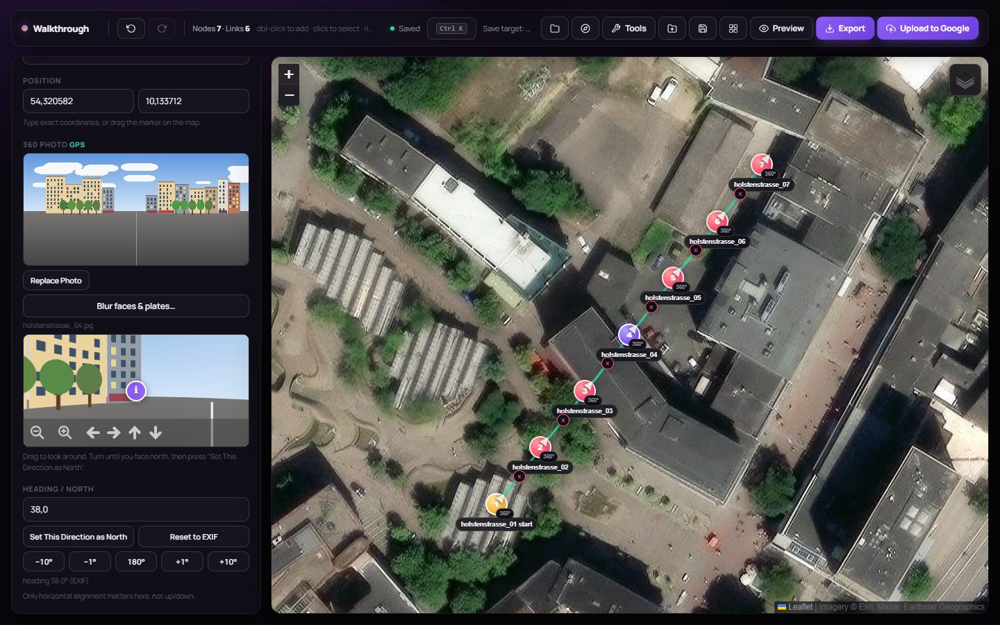
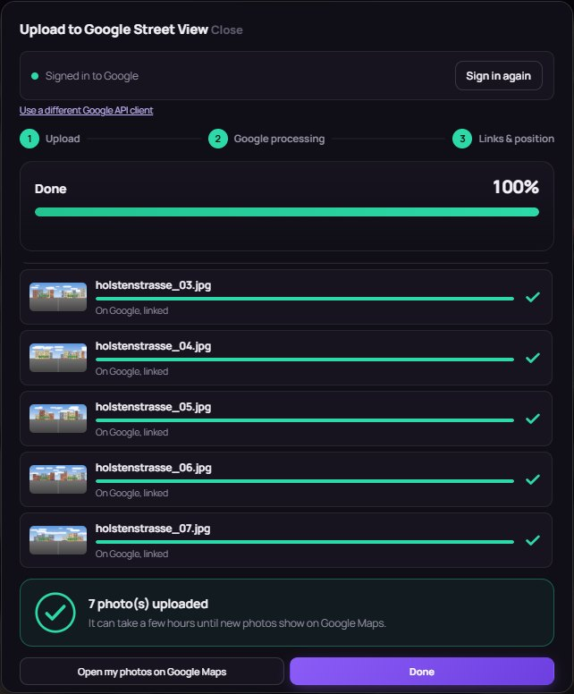
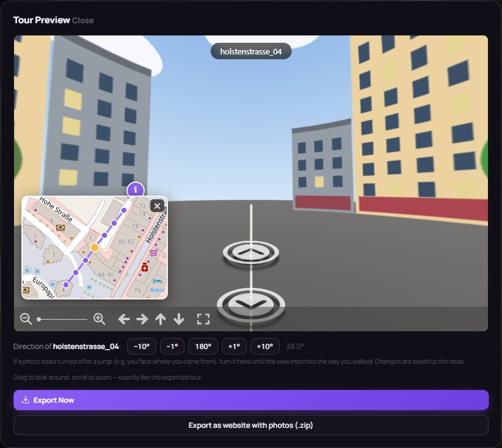
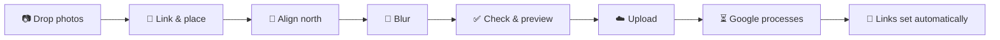

<div align="center">

# Streetview Tour Editor

**Turn a walk with your 360° camera into a connected Google Street View tour.**<br>
Place, link and align your panoramas on a map, blur faces, preview the walkthrough,
and publish everything to Google Maps with one click.

[](https://github.com/F0uP/streetview-tour-uploader/releases/latest)
[](https://github.com/F0uP/streetview-tour-uploader/releases)
[](https://github.com/F0uP/streetview-tour-uploader/actions/workflows/build-release.yml)
[](LICENSE)


[**Download for Windows**](https://github.com/F0uP/streetview-tour-uploader/releases/latest) ·
[Quick start](#quick-start) ·
[Google setup](#one-time-google-setup) ·
[User guide](#user-guide) ·
[FAQ](#faq--troubleshooting)



</div>

---

## Why

Google Street View lets anyone publish 360° photos, and connected photos become a
walkable tour on Google Maps. Google's own tools for this are gone, and the
[Street View Publish API](https://developers.google.com/streetview/publish) is
not something you want to drive by hand. This editor does the whole job: from a
folder of panoramas from a RICOH THETA, Insta360, GoPro MAX or any other 360°
camera to a published, linked tour.

Everything runs on your own computer. Your photos only leave it when you upload
them to Google.

## Features

| | |
|---|---|
| 🗺️ **Plan on a map** | Drop your 360° JPEGs on a street or satellite map; photos with GPS land where they were taken. Link them by right-clicking, or let **auto-connect** chain them in the order you walked. |
| 🧭 **Get north right** | Align a photo by looking north and clicking once, fine-tune by ±1°/±10°/180°, or set every photo from the **walking direction**. The preview shows the result exactly as visitors will see it. |
| 📍 **No GPS? No problem** | Place photos from a **GPX track** recorded on your phone, or type exact coordinates. |
| 🙈 **Privacy built in** | **Blur faces and licence plates** before uploading, with automatic face detection as a starting point. The Street View Publish API does not blur anything itself. |
| ✅ **Catch problems early** | A **tour check** finds what Google would reject (not 2:1, not a JPEG, over 75 MB) and what looks wrong (no north, unconnected photos, long links, duplicates). |
| ☁️ **One-click publishing** | Upload with a live progress view, readable errors and automatic linking once Google has processed the photos. Later changes are **pushed without re-uploading**; the Google status shows on every marker. |
| 🌐 **Share it anywhere** | Export a **ready-to-host website** of the tour (with info points and a minimap), or `tour-viewer.html` / `tour-config.json` / `tour.csv`. |
| 💾 **Never lose work** | Autosave, a restore prompt after a crash, and `.vrtour` project files with all photos inside. **Ctrl+S** saves back into the open project. |
| 🖥️ **A real desktop app** | Windows installer, tray icon, `.vrtour` file association and in-app updates. English and German user interface. |

<table>
  <tr>
    <td width="50%"></td>
    <td width="50%"></td>
  </tr>
  <tr>
    <td align="center"><sub>Upload: progress, per-photo status, automatic linking</sub></td>
    <td align="center"><sub>Preview: walk the tour, fix a photo's direction on the spot</sub></td>
  </tr>
</table>

## Quick start

### Windows: installer (recommended)

1. Download **`StreetviewTourEditor-<version>-Setup.exe`** from the
   [latest release](https://github.com/F0uP/streetview-tour-uploader/releases/latest) and run it.
   No admin rights needed.
2. Start **Streetview Tour Editor** from the Start menu. It runs in the
   notification area (next to the clock) and opens the editor in your browser.
3. Drop your 360° photos onto the map.

> [!NOTE]
> Releases aren't code-signed yet, so Windows SmartScreen may say *"Windows protected your PC"*.
> Click **More info → Run anyway**. Each release has a `SHA256SUMS.txt` to verify the download.

Prefer not to install anything? The release also has a
**`…-portable.zip`**: unzip it anywhere and run `StreetviewTourEditor.exe`.

### Any OS: run from source

Requires **Python 3.9+** and a current browser (Chrome or Edge recommended).

```bash
git clone https://github.com/F0uP/streetview-tour-uploader.git
cd streetview-tour-uploader
pip install -r requirements.txt
python run_editor.py
```

The editor opens at <http://127.0.0.1:8420/editor.html>. Keep the terminal open
while you work; <kbd>Ctrl</kbd>+<kbd>C</kbd> stops it.

## One-time Google setup

Every app that publishes to Street View must be registered with Google as an
**OAuth client**: Google offers no other way. It's free, takes about five
minutes, and you only do it once. The editor walks you through it: click
**Upload to Google** and follow the five steps, each with a link to the right
page.

<details>
<summary><b>The steps in detail</b></summary>

1. [Create a Google Cloud project](https://console.cloud.google.com/projectcreate)
   (any name) and make sure it is selected at the top.
2. [Enable the Street View Publish API](https://console.cloud.google.com/apis/library/streetviewpublish.googleapis.com).
3. [Set up the OAuth consent screen](https://console.cloud.google.com/apis/credentials/consent):
   any app name, your e-mail, audience **External**, then add your own Google
   address under **Audience → Test users**.
4. [Create an OAuth client](https://console.cloud.google.com/apis/credentials/oauthclient)
   of type **Desktop app**.
5. Paste the **Client ID** and **Client Secret** into the editor, or choose the
   downloaded `client_secret_….json`, and click **Save & Continue**. Then
   **Sign in with Google**.

</details>

> [!IMPORTANT]
> While the consent screen is in **Testing** mode, Google ends the sign-in after
> **7 days**. The editor then shows *"Sign-in expired"*. Just sign in again. To
> avoid that, set the consent screen's publishing status to **In production**
> (Google may show an *"unverified app"* warning on sign-in, which you can
> continue past for your own account).

The Client ID/Secret and the sign-in token stay on your computer:
`%APPDATA%\StreetviewTourEditor\` for the Windows app, `uploader/` when running
from source. They are never part of a build or a project file.

## User guide



### 1. Bring in your photos

- **Drop 360° JPEGs** onto the map (or several at once). Photos with GPS in their
  EXIF/XMP data land at their position; others where you drop them.
- **No GPS?** Record a track with any GPS logger app while shooting, then use
  **Tools → Place photos from GPX track…**. Set the camera clock's time zone
  if the photos don't land on the track.
- **Double-click** the map for an empty point; **Replace Photo** in the side
  panel swaps a node's photo.

### 2. Link the photos

- **Right-click** a node, then **right-click** the next one. Click the **×** on a
  line to remove the link.
- **Tools → Auto-connect nodes…** links them in the order the photos were taken
  (capture time) or to their nearest neighbours, up to a distance you choose.
- **Shift+drag** on the map or **Ctrl+click** selects several nodes; the bar at
  the bottom connects or deletes them in one go.

### 3. Align north

Each photo needs to know which way its centre faces, or arrows point the wrong
way and you look backwards after a jump.

- Select a node, turn the small panorama until you face **north** (the
  satellite map helps), and click **Set This Direction as North**.
- Fine-tune with **−10° / −1° / 180° / +1° / +10°**. **180°** fixes a photo taken
  facing backwards.
- **Tools → Headings from walking direction…** sets all photos at once: align one
  by hand, pick it as reference, and the others follow your route.

> [!TIP]
> In the **Preview**, walk through the tour. If a photo looks turned after a jump,
> use the buttons under the viewer: they turn the photo you are standing in, live.

### 4. Protect privacy

Select a node and click **Blur faces & plates…**:

- **Detect faces** suggests boxes (dashed); click a box to remove it.
- Drag boxes over anything else, such as licence plates or house numbers.
- **Apply to photo** pixelates them for good. The original EXIF block, which can
  hold an unblurred thumbnail, is dropped; the 360° metadata is kept.

If the photo was already uploaded, the next upload replaces it and deletes the
unblurred version on Google.

### 5. Check and preview

- **Tools → Check tour…** lists errors (block the upload) and warnings, each with
  a **Show** button.
- **Preview** shows the tour exactly as it will look, including info points and the
  minimap.
- **Info points:** in the side panel, **Add info point at current view** puts a
  clickable "i" with a title, text and link into the panorama.

### 6. Upload to Google Street View

Click **Upload to Google**, then **Start Upload**:

1. **Upload:** each photo is sent with its position and heading, with live progress, speed and time left.
2. **Google processing:** new photos take a few minutes before Google accepts links. The dialog waits.
3. **Links & position:** connections are set on Google.

Good to know:

- **Only what changed is sent.** Running the upload again uploads new photos only;
  moved, turned or re-linked photos are **updated on Google without re-uploading**.
- Photos Google hasn't finished yet get their links **automatically in the
  background** while the editor is open.
- **Check status on Google** shows per photo whether it is *published*, *processing*
  or *rejected* (coloured dot on the marker, link to Google Maps in the side panel).
- A **Place ID** (optional) links the tour to a place's page on Google Maps. Find it
  with Google's free [Place ID Finder](https://developers.google.com/maps/documentation/javascript/examples/places-placeid-finder);
  pasting a Maps URL that contains one works too. If Google rejects the ID, the
  photos are uploaded without it and you are told.

> [!WARNING]
> Uploaded photos are **public**, under your Google account. It can take from a
> few minutes to several hours until they show on Google Maps.

### 7. Save, share and export

| | |
|---|---|
| **Save project** (<kbd>Ctrl</kbd>+<kbd>S</kbd>) | A `.vrtour` file: one zip with the tour and all photos. Chrome/Edge save straight back into it; Firefox downloads a copy. Double-click it to open it in the Windows app. |
| **Export as website** | `Tools → Export tour as website (.zip)`: `index.html` + photos, ready for any web space. |
| **Export** | `tour-viewer.html` + `tour-config.json`, to place next to your photos. |
| **CSV** | `tour.csv` for the [command-line uploader](#command-line-tools). |

The editor also **autosaves** in the browser. After a crash or closed tab it
offers to restore the last session.

### Keyboard shortcuts

| Action | Shortcut |
|---|---|
| Command palette (all actions) | <kbd>Ctrl</kbd>+<kbd>K</kbd> |
| Save / Save as / Open project | <kbd>Ctrl</kbd>+<kbd>S</kbd> / <kbd>Ctrl</kbd>+<kbd>Shift</kbd>+<kbd>S</kbd> / <kbd>Ctrl</kbd>+<kbd>O</kbd> |
| Undo / Redo | <kbd>Ctrl</kbd>+<kbd>Z</kbd> / <kbd>Ctrl</kbd>+<kbd>Y</kbd> |
| Add point | Double-click the map |
| Connect two nodes | Right-click, right-click |
| Select several | <kbd>Ctrl</kbd>+click, or <kbd>Shift</kbd>+drag on the map |
| Delete selection | <kbd>Delete</kbd> |
| Cancel / deselect | <kbd>Esc</kbd> |
| All shortcuts | <kbd>?</kbd> |

## FAQ & troubleshooting

<details>
<summary><b>"Sign-in expired" / uploads fail with "not signed in"</b></summary>

Google ends the sign-in after 7 days while your OAuth consent screen is in
*Testing* mode. Click **Sign in with Google** again, or switch the consent
screen to *In production* (see [Google setup](#one-time-google-setup)).
</details>

<details>
<summary><b>Google rejected the Place ID</b></summary>

The photos are uploaded without a place in that case. Look the place up in the
[Place ID Finder](https://developers.google.com/maps/documentation/javascript/examples/places-placeid-finder)
and copy the ID it shows (usually starting with `ChIJ`). Not every address has a
Place ID Google accepts for Street View photos.
</details>

<details>
<summary><b>The status says "processing" for a long time</b></summary>

That's Google, not the editor: new photos can take hours to be published. Links
and position updates are sent automatically as soon as Google accepts them. Keep
the editor open, or press **Start Upload** again later. Nothing is uploaded twice.
</details>

<details>
<summary><b>A photo faces the wrong way, or I look backwards after a jump</b></summary>

Its north is off, often because the camera's compass was. Open **Preview**, walk
to that photo and use **180°** or **±10°** under the viewer, or fix it in the side
panel. Then upload again: only the heading is sent.
</details>

<details>
<summary><b>Google says it's not a 360° photo</b></summary>

The photo must be a 2:1 equirectangular JPEG. Image editors such as GIMP often
strip the 360° (GPano XMP) metadata on save; `uploader/restore_xmp.py` copies it
back from the originals. The tour check warns about both.
</details>

<details>
<summary><b>The map stays grey / "Access blocked"</b></summary>

Don't open `editor/editor.html` by double-click: OpenStreetMap blocks map tiles
for `file://` pages. Start the app (or `python run_editor.py`) and use
<http://127.0.0.1:8420/editor.html>.
</details>

<details>
<summary><b>"Could not start on port 8420"</b></summary>

Another program, often a second copy of the editor, uses the port. Quit the other
copy from its tray icon and start again.
</details>

<details>
<summary><b>Where are my files?</b></summary>

| What | Where |
|---|---|
| Google client & sign-in (Windows app) | `%APPDATA%\StreetviewTourEditor\` (also `editor.log`) |
| Google client & sign-in (from source) | `uploader/client_secrets.json`, `uploader/token.json` |
| Autosaved session | Your browser's storage for `127.0.0.1:8420` |
| Projects | Wherever you save your `.vrtour` files |
</details>

## Command-line tools

For scripting and batch jobs, the [`uploader/`](uploader) folder has
stand-alone scripts. They share the sign-in with the editor.

| Script | What it does |
|---|---|
| `upload_tour.py` | Upload a folder of photos. Without a manifest it links them in file order; with `--manifest tour.csv` it uses your links. `--place-id`, `--dry-run`, `--connect-only`. |
| `gen_tour_csv.py` | Build `tour.csv` from an exported `tour-config.json` plus the photos' EXIF GPS. |
| `retry_failed.py` | Re-upload only the photos that failed, then redo the links. |
| `restore_xmp.py` / `restore_exif.py` | Copy 360° metadata / GPS back into photos an image editor stripped. |
| `find_place_id.py` | Look up a Place ID by name (needs a Google Maps API key). |

```bash
python uploader/gen_tour_csv.py --config tour-config.json --folder photos --out photos/tour.csv
python uploader/upload_tour.py  --folder photos --manifest photos/tour.csv --dry-run
```

See [`example/`](example) for the CSV format and `tour-meta.json` (a Place ID for a whole folder).

## Privacy & security

- The editor is a small local web server bound to `127.0.0.1`. It only answers
  requests from its own page (host and origin are checked), so other websites
  can't use it.
- Photos and projects stay on your computer until you upload them; uploads go
  directly to Google's Street View Publish API.
- In-app updates download only from this repository's GitHub releases and are
  checked against the release's `SHA256SUMS.txt` before installing.
- Libraries (map, panorama viewer, face detection) load from public CDNs, and map
  tiles from OpenStreetMap and Esri, so an internet connection is needed.

## Development

<details>
<summary><b>Project layout</b></summary>

```text
editor/editor.html        the whole editor (single page, no build step)
run_editor.py             local server, Google API endpoints, desktop-app entry point
app_tray.py               tray icon of the Windows app
app_update.py             in-app updates from GitHub Releases
uploader/                 command-line tools
installer/                Inno Setup script and app icon
packaging/winget/         winget manifest generator
build_exe.py              builds the app, portable zip, installer and checksums
.github/workflows/        CI: build and release on every v* tag
```
</details>

<details>
<summary><b>Building the Windows app</b></summary>

```bash
pip install -r requirements.txt pyinstaller
winget install JRSoftware.InnoSetup     # only for the Setup.exe
python build_exe.py                      # version from `git describe`
python build_exe.py --version 2.2.0      # explicit version
```

Output in `dist/`: the app folder, `…-portable.zip`, `…-Setup.exe` and
`SHA256SUMS.txt`. `--no-installer` skips Inno Setup; `--console` builds with a
console window for debugging.
</details>

<details>
<summary><b>Releasing</b></summary>

Push a tag and GitHub Actions builds and publishes the release. Installed copies
offer the update on their next start:

```bash
git tag v2.2.0 && git push origin v2.2.0
```

**Run workflow** in the Actions tab builds without releasing. Optional repository secrets:

- **Code signing** (removes the SmartScreen warning) via
  [Azure Trusted Signing](https://learn.microsoft.com/azure/trusted-signing/):
  `AZURE_TENANT_ID`, `AZURE_CLIENT_ID`, `AZURE_CLIENT_SECRET`,
  `TRUSTED_SIGNING_ENDPOINT`, `TRUSTED_SIGNING_ACCOUNT`, `TRUSTED_SIGNING_PROFILE`.
  Locally, set `SIGN_CMD` to any signing command with `{file}` as placeholder.
- **winget**: `WINGET_TOKEN`; the first submission is manual, see
  [packaging/winget/README.md](packaging/winget/README.md).
</details>

Contributions are welcome: open an [issue](https://github.com/F0uP/streetview-tour-uploader/issues)
or a pull request. Please test changes in Chrome and Firefox.

## Credits

Originally created by [Koji Takada](https://github.com/takadakoji-jp/streetview-tour-uploader),
extended by [F0uP](https://github.com/F0uP). Built with
[Leaflet](https://leafletjs.com/),
[Photo Sphere Viewer](https://photo-sphere-viewer.js.org/),
[exifr](https://github.com/MikeKovarik/exifr) and
[MediaPipe](https://ai.google.dev/edge/mediapipe); maps ©
[OpenStreetMap](https://www.openstreetmap.org/copyright) contributors and
imagery © Esri. Not affiliated with Google.

## License

[MIT](LICENSE)
